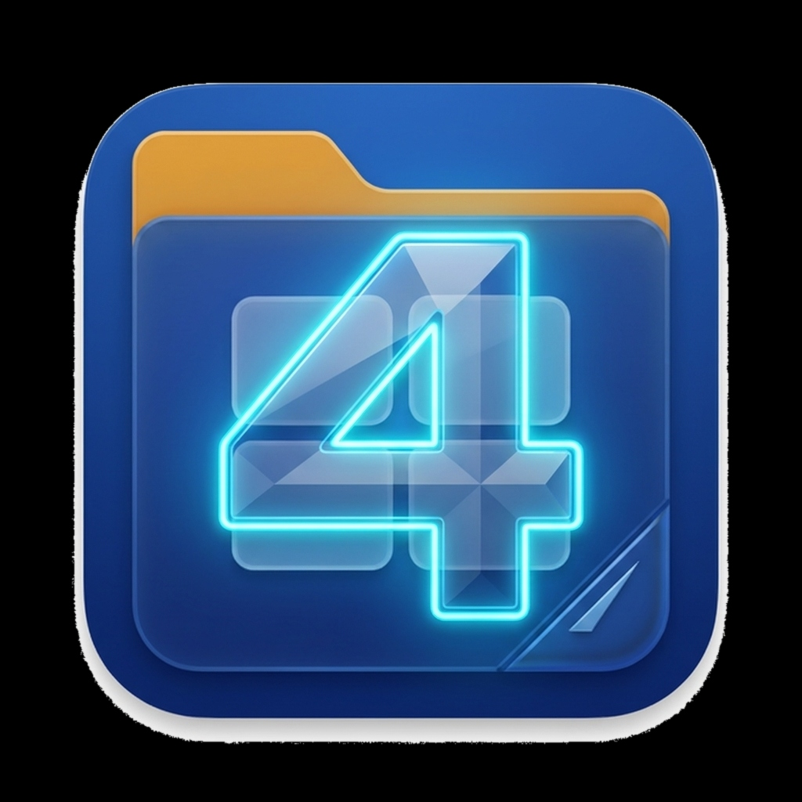

#  QuadCommander Releases

QuadCommander 공식 설치 파일 및 릴리즈 배포 저장소입니다.

[**최신 버전 다운로드 (Releases)**](https://github.com/namoman/quad-commander-releases/releases) | [공식 웹사이트](https://qc.namo.page)

---

## 주요 기능

- **4분할 화면**: 1, 2, 3, 4분할 즉시 전환 및 다중 탐색
- **8종 멀티 테마 엔진**: 다크·라이트·OLED 블랙부터 M-dir, 노턴 커멘더, 윈도우 11, 윈도우 98, macOS Finder 스타일까지 원클릭 전환
- **패널 간 빠른 전송**: `F5` 복사, `F6` 이동, 드래그 앤 드롭 지원
- **대용량 초고속 탐색**: 수만 개 파일도 지연 없는 즉시 렌더링
- **키보드 중심 조작**: `Tab` 패널 전환, `Space` 다중 선택, `F2` 이름 변경, `Ctrl+Shift+P` 명령어 팔레트
- **비동기 작업 큐**: 백그라운드 파일 전송 및 충돌 방지 처리

---

## 지원 테마 (8종)

메뉴바 `보기(W) → 스킨 / 테마`, 툴바 우측 테마 버튼, 또는 `Ctrl+Shift+P` 명령어 팔레트에서 즉시 전환할 수 있습니다.

| 테마 | 스타일 특징 |
| :--- | :--- |
| **다크 테마 (Dark Slate)** | 모던하고 차분한 기본 슬레이트 다크 |
| **라이트 테마 (Pure White)** | 밝고 깨끗한 오피스 화이트 |
| **블랙 테마 (Pure OLED Black)** | 완전 블랙(`#000000`) 기반 고대비 OLED |
| **M-dir 스타일 (Classic DOS)** | 국산 DOS 파일 관리자 Mdir III 감성 (옐로우/시안 + 하단 기능키 바) |
| **노턴 커멘더 스타일 (NC Blue)** | 클래식 DOS 딥 블루 & 시안 + 하단 기능키 바 |
| **윈도우 11 탐색기 (Fluent Mica)** | 플루언트 라운드 탭, 밝은 미카 톤 & 앰버 폴더 |
| **윈도우 98 레트로 (Classic 3D)** | 클래식 회색 3D 베벨 입체 버튼 & 네이비 활성 타이틀 |
| **macOS Finder 스타일 (Apple Modern)** | 스카이블루 폴더 & 라운드 필 UI (창 제어 `_ □ ✕`는 윈도우 표준 우측 배치) |

---

## 다운로드 및 설치 안내

[Releases 페이지](https://github.com/namoman/quad-commander-releases/releases)에서 환경에 맞는 패키지를 다운로드하세요.

- **설치형 (`Setup.exe`)**: 일반 권장 설치 파일
- **무설치 포터블 (`Portable.exe`)**: 별도 설치 없이 바로 실행 가능한 단일 파일

---
© namoman
